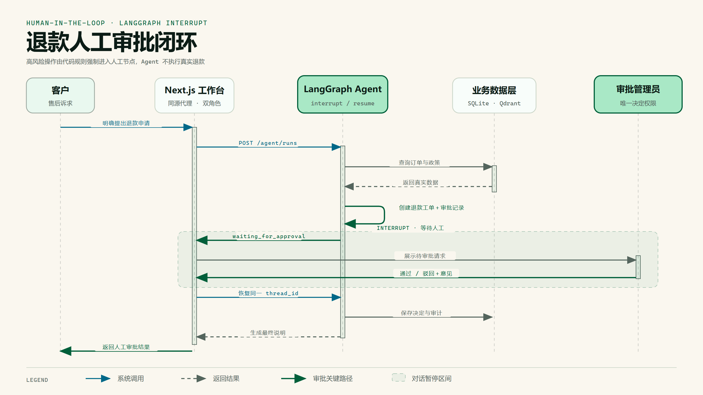
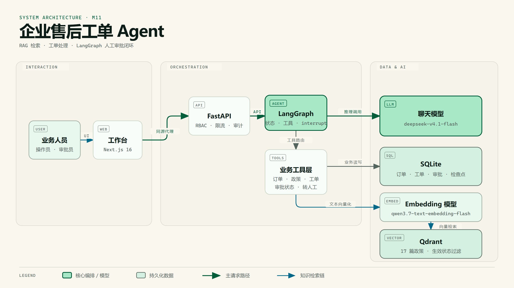

# Support Agent Workbench

<p align="center">
  <strong>一个可在本地复现、面向生产设计的企业售后 Agent 参考实现。</strong>
</p>

<p align="center">
  LangGraph · RAG · Human-in-the-loop · FastAPI · Next.js · Qdrant · Docker
</p>

<p align="center">
  
  
  
  
  
  
</p>

本项目展示如何把大模型从“回答问题的聊天程序”组织成一个具备真实业务工具、政策依据、人工审批、权限边界和持久化状态的完整 Agent 工作流。

它不是实际执行退款的生产系统，也不提供在线 Demo；所有订单和政策均为虚构数据，可通过 Docker 在本地完整复现。

## 项目定位

普通 Agent Demo 通常只有：

```text
用户输入 → 调用模型 → 返回回答
```

本项目处理的是更接近企业业务的链路：

```text
用户请求
  → 身份与权限校验
  → Agent 调用订单与政策工具
  → 创建售后工单
  → 高风险退款进入人工审批
  → 暂停并持久化当前会话
  → 审批后恢复同一条对话
  → 返回有依据、可审计的处理结果
```

核心目标不是让模型拥有更多权限，而是在模型之外建立明确的业务规则、安全边界和人工责任。

## 核心能力

- **业务工具调用**：查询订单、检索政策、创建工单、查询审批状态和转交人工。
- **政策 RAG**：使用 Qwen Embedding 与 Qdrant 检索演示政策，回答中标注来源与版本。
- **人工审批闭环**：通过 LangGraph `interrupt()` 暂停高风险退款流程，并从同一个 `thread_id` 恢复。
- **代码级风险保护**：退款工单由业务规则强制创建审批，不能仅靠 Prompt 决定是否绕过。
- **双角色工作台**：操作员负责处理工单，审批管理员拥有退款批准与驳回权限。
- **状态与审计**：SQLite 保存订单、工单、审批和 Agent 检查点，JSON 日志记录运行轨迹。
- **可靠性保护**：外部读取设置超时与有限重试，写操作不自动重试，并提供请求限流和失败保护。
- **可复现运行**：FastAPI、Next.js、Qdrant 和初始化任务统一由 Docker Compose 管理。

## 快速启动

### 前置条件

- Docker Desktop 或 Docker Engine + Compose
- 阿里云百炼 API Key

### 1. 创建配置

Windows PowerShell：

```powershell
Copy-Item .env.example .env
```

macOS / Linux：

```bash
cp .env.example .env
```

编辑 `.env`，至少替换以下配置：

```dotenv
DASHSCOPE_API_KEY=your-dashscope-api-key
ADMIN_TOKEN=your-random-admin-token
OPERATOR_TOKEN=your-random-operator-token
WORKBENCH_ADMIN_PASSWORD=your-strong-admin-password
WORKBENCH_OPERATOR_PASSWORD=your-strong-operator-password
WORKBENCH_SESSION_SECRET=at-least-32-random-characters
```

真实 `.env` 已被 Git 忽略，不要把密钥提交到仓库。

### 2. 启动服务

```bash
docker compose build
docker compose up -d
```

首次启动需要导入演示政策：

```bash
docker compose --profile tools run --rm knowledge-init
```

确认服务状态：

```bash
docker compose ps
```

### 3. 访问

- 工作台：<http://localhost:3000>
- FastAPI 文档：<http://127.0.0.1:8000/docs>
- 健康检查：<http://127.0.0.1:8000/health>

默认用户名为 `operator` 和 `admin`，密码使用 `.env` 中配置的值。演示订单可使用 `A1001`、`A1002`、`A1003`。

## 人工审批闭环

退款不是由 Agent 自主执行的动作。用户明确提出退款后，系统会创建退款工单和审批记录，并在 LangGraph 主图中暂停当前对话。

审批管理员作出决定后，FastAPI 使用同一个 `thread_id` 恢复原会话；Agent 再根据人工决定向用户说明下一步。即使审批通过，状态也只是 `approved_pending_execution`，不会触发真实资金操作。



## 系统架构



- **Next.js 工作台**：提供登录、工单队列、对话轨迹、审批和人工接管界面。
- **FastAPI**：提供 API、角色鉴权、请求限流、错误保护和可观测性入口。
- **LangGraph**：管理模型、工具、会话状态以及人工审批的暂停与恢复。
- **SQLite**：保存演示订单、工单、审批记录和 LangGraph 检查点。
- **Qdrant**：保存政策向量，并通过 Payload 过滤失效政策。
- **百炼模型服务**：聊天模型使用 `deepseek-v4.1-flash`，Embedding 使用 `qwen3.7-text-embedding-flash`。

## 权限与安全边界

| 能力 | 操作员 | 审批管理员 |
|---|:---:|:---:|
| 查询订单和工单 | ✅ | ✅ |
| 运行 Agent | ✅ | ✅ |
| 创建工单和转人工 | ✅ | ✅ |
| 查看退款审批 | ✅ | ✅ |
| 批准或驳回退款 | ❌ | ✅ |

主要安全设计：

- 浏览器只访问 Next.js 同源代理，不直接接触 FastAPI 的角色 Token。
- 登录成功后使用签名 HttpOnly Cookie 保存会话。
- 审批人身份由服务端注入，不能通过请求体伪造。
- 高风险退款由代码规则强制进入审批节点，而不是依赖模型自觉调用工具。
- FastAPI 只绑定宿主机回环地址，Qdrant 不映射宿主机端口。
- 容器采用非 root 用户、只读根文件系统、能力丢弃和资源限制。

## 技术栈

| 层级 | 技术 |
|---|---|
| Agent 编排 | LangGraph |
| 聊天模型 | `deepseek-v4.1-flash` |
| Embedding | `qwen3.7-text-embedding-flash` |
| RAG / 向量库 | Qdrant |
| 业务数据与检查点 | SQLite · SQLAlchemy |
| 后端 API | FastAPI |
| 前端工作台 | Next.js 16 · React 19 |
| 评测与日志 | 固定 JSONL 用例 · 脱敏 JSON 日志 |
| 部署 | Docker Compose |

## 已知限制

- 项目只提供本地运行，不提供长期在线 Demo。
- 账号和密码来自环境变量，属于演示级身份系统；真实企业环境应接入 OIDC、MFA 和用户级审计。
- SQLite 和进程内限流只适合单 API 副本；水平扩展前应迁移 PostgreSQL、共享检查点和 Redis 或网关限流。
- 审批通过不等于退款已经执行；本项目不连接真实支付或退款系统。
- 知识库、订单、政策和评测数据均为虚构演示数据，不代表任何企业承诺。
- 固定评测结果用于回归和工程展示，不代表生产环境 SLA。

更多部署边界见 [部署说明](docs/DEPLOYMENT.md)。

## License

本项目采用 [MIT License](LICENSE)。
